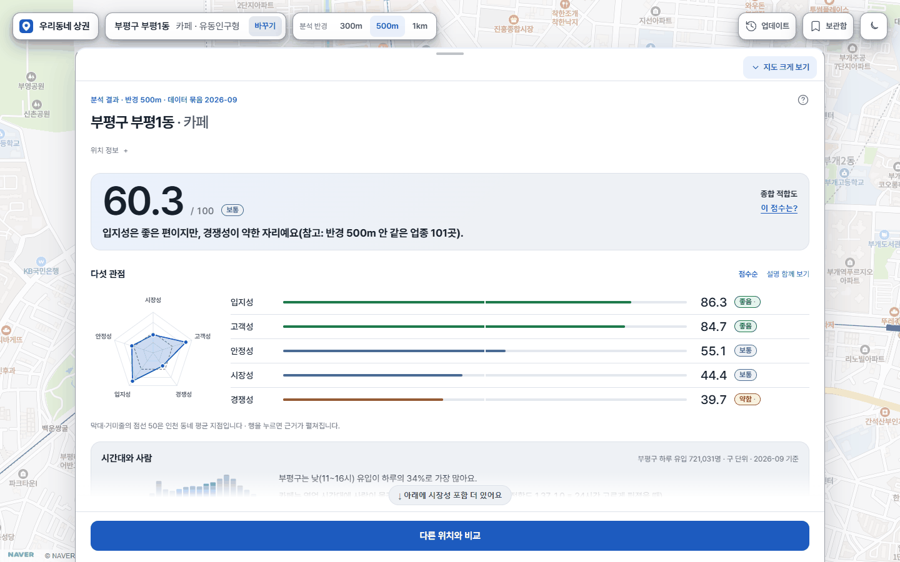
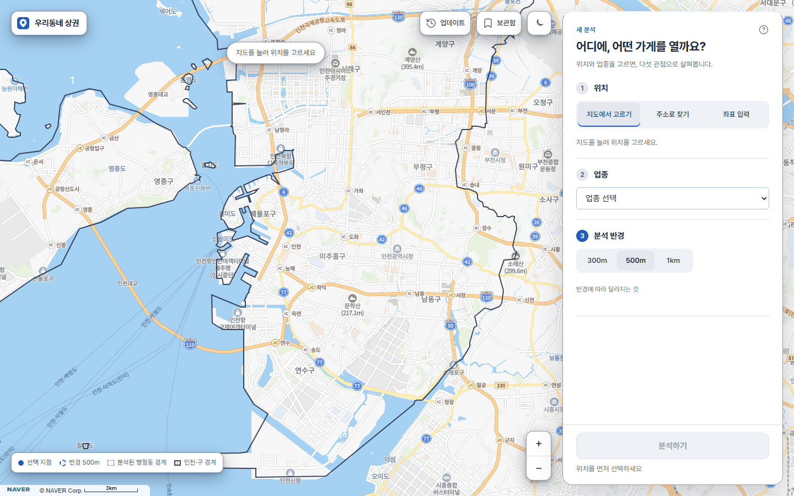
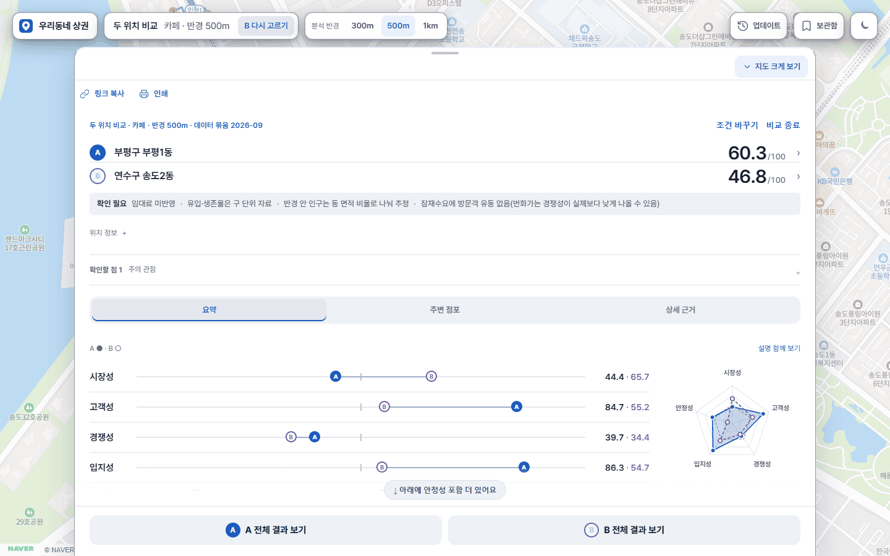
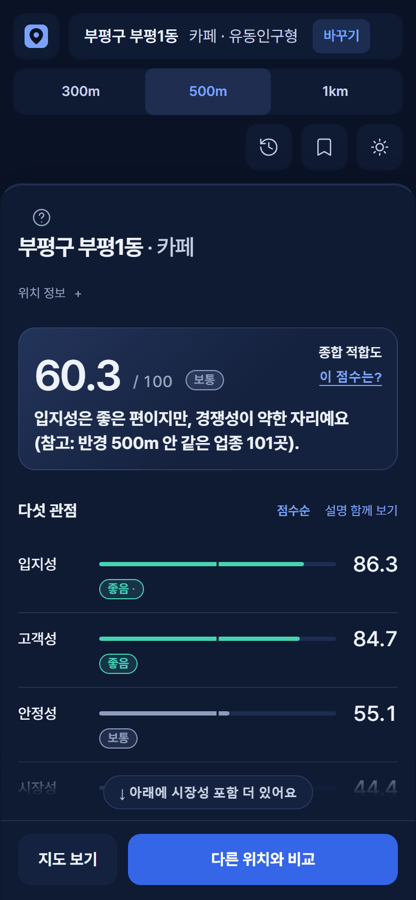
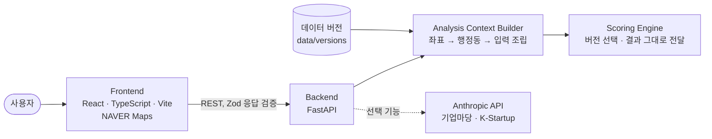

<div align="center">

# 🗺️ 우리동네 상권분석 매니저

**인천 지도에서 자리와 업종을 고르면, 그 자리를 다섯 관점으로 살펴 줍니다.**

예비 창업자가 "여기에 이 가게를 열어도 될까?"를 공개 데이터로 먼저 따져 보는 웹 서비스입니다.

[](https://github.com/Ow-wL/harness-commercial/actions/workflows/check.yml)   

    



</div>

> [!IMPORTANT]
> **점수는 매출이나 성공 확률이 아닙니다.** 인천의 다른 동네와 견준 상대 위치입니다. 음식 9개 업종으로 사후 검증한 결과, 점수가 높은 곳일수록 3년 생존율이 높다는 일관된 관계는 확인되지 않았습니다(평균 순위상관 −0.067, 95% 구간 −0.179~+0.042). 입력 자료가 비교 대상 개업 시기보다 뒤여서 예측 성능을 잰 값도 아닙니다. → [검증 문서](docs/VALIDATION_2026-11-01.md)

## 목차

[화면](#-화면) · [주요 기능](#-주요-기능) · [다섯 관점](#-다섯-관점) · [구조](#%EF%B8%8F-구조) · [빠른 시작](#-빠른-시작) · [검증](#-검증) · [배포](#-배포) · [데이터 출처](#%EF%B8%8F-데이터-출처) · [문서](#-문서)

## 📸 화면

<table>
  <tr>
    <td width="50%" align="center"><br><sub><b>시작</b> — 지도에서 자리를 누르고 업종과 반경을 고릅니다</sub></td>
    <td width="50%" align="center"><br><sub><b>두 위치 비교</b> — 관점별 차이를 한 화면에서 봅니다</sub></td>
  </tr>
  <tr>
    <td colspan="2" align="center"><br><sub><b>모바일·다크 테마</b></sub></td>
  </tr>
</table>

<sub>운영 화면(앱 v0.3.4·엔진 v0.5.1·데이터 2026-09)에서 찍었습니다(2026-11-10). 결과는 지도 위로 끌어올리는 시트로 보이고, 지도를 크게 본 뒤에도 이전 결과로 돌아올 수 있습니다. 지도 © NAVER Corp.</sub>

## ✨ 주요 기능

| | 기능 | 내용 |
|---|---|---|
| 📍 | **위치 고르기** | 지도 클릭, 주소 검색, 역 이름, 좌표 입력 |
| 🏪 | **업종 29개** | 고객밀착형·유동인구형·목적방문형·체류소비형, 유형마다 관점 가중치가 다릅니다 |
| ⭕ | **분석 반경** | 300m · 500m · 1km, 반경별 비교 표 |
| 📊 | **결과 대시보드** | 지도 위로 끌어올리는 결과 시트 — 종합 점수와 등급, 한 줄 결론, 거미줄 그래프, 점수순 관점 막대, 근거 펼쳐 보기 |
| 🏆 | **업종 순위** | 같은 자리에서 점수가 높은 업종 순서 |
| 🕒 | **시간대와 사람** | 구 단위 시간대별 유입, 가까운 지하철역 승하차(점수와 무관) |
| ⚠️ | **규제 경고** | 학교 주변 규제 업종이면 점수 위에 경고를 펼쳐 보입니다 |
| ⚖️ | **두 위치 비교** | A·B 관점별 차이, 거미줄 겹쳐 보기 |
| 🤖 | **AI 요약·질문** | 분석 자료만 근거로 답하고 문장마다 근거를 표시합니다. 하루·월 사용 한도가 있습니다 |
| 💰 | **지원사업 공고** | 업종·지역에 맞는 공고(기업마당·K-Startup)를 마감일과 함께 보여 줍니다 |
| 🔖 | **활용 도구** | 조건 공유 링크, 후보 보관함, 인쇄 요약, 현장 확인 카드 |
| 🌗 | **편의** | 라이트·다크 테마, 첫 방문 안내, 업데이트 내역 |

> 장소 이름 검색은 구현되어 있지만 서버에 NAVER 검색 키가 없어 지금 운영에서는 꺼져 있습니다.

## 🧭 다섯 관점

| 관점 | 무엇을 보나 | 자료 단위 |
|---|---|---|
| **시장성** | 구로 들어오는 사람 수, 업종에 맞는 시간대인지 | 구 |
| **고객성** | 타겟 연령 인구, 종사자, 1인 가구 | 행정동 |
| **경쟁성** | 반경 안 같은 업종 점포와 점포당 잠재 수요 | 반경 |
| **입지성** | 지하철역까지의 거리와 역세권 강도, 유인시설 | 좌표 |
| **안정성** | 3년 생존율, 폐업률, 평균 업력, 임대료(최대 13개 업종만 산출) | 구·상권 |

각 지표는 인천 안 비교 집단에서의 상대 위치로 바꾼 뒤, 업종 유형별 가중치로 합칩니다. 자세한 내용은 [ENGINE.md](docs/ENGINE.md)와 [ENGINE_V0_5.md](docs/ENGINE_V0_5.md)에 있습니다.

## 🏗️ 구조



- **Frontend는 엔진을 직접 부르지 않습니다.** 화면에 맞춘 변환은 엔진 밖에서 합니다.
- **점수 계산은 새 엔진 버전으로만 바꿉니다.** 앱 버전, 엔진 버전, 데이터 버전을 따로 관리합니다.
- **FastAPI 하나가 API와 화면을 같은 주소로 제공합니다.** 운영에는 Node 서버가 없습니다.

<details>
<summary><b>저장소 구성</b></summary>

```text
backend/          FastAPI: 분석·점포·AI·지원사업 API, 오류 계약, 사용 제한
frontend/         React 앱: 지도·조건·결과 화면, 패치노트(src/content/patchNotes.json)
scoring_engine/   엔진 사본(v0_3 · v0_4 · v0_5 · v0_5_1) + 로더·캐시·location·service
sources/          팀이 전달한 원본 (읽기 전용, 해시 검증)
data/
  runtime/        기본 입력 데이터 (팀 가공본과 바이트 동일)
  versions/       데이터 버전 묶음 (데이터 파일은 git 밖)
  geo/            인천 행정동·구 경계
  extra/          화면 전용 자료 (점수에 쓰지 않음)
scripts/          check, 배포, 데이터 ETL, smoke, 검증 재현
tests/            무결성, 엔진, golden regression, 데이터 스키마
docs/             설계·결정·작업·배포 기록
```

</details>

## 🚀 빠른 시작

**필요한 것:** Python 3.10+ · Node `^20.19` 또는 `>=22.12` · NAVER Maps Client ID

```powershell
.\scripts\setup.ps1                 # .venv 생성과 Python 의존성 설치 (bash: scripts/setup.sh)
```
```powershell
npm --prefix frontend install       # 프런트 의존성 설치
```

`frontend/.env`를 만들어 `VITE_NAVER_MAP_CLIENT_ID`를 넣습니다. NAVER 콘솔의 Web 서비스 URL에 `http://localhost:5173`도 등록해야 지도가 뜹니다.

```powershell
.\.venv\Scripts\python.exe scripts\run_local_backend.py    # backend — http://127.0.0.1:8000, 운영과 같은 엔진 v0.5.1
```
```powershell
npm --prefix frontend run dev                              # frontend — http://localhost:5173
```

업종 사전 계산(warm)은 뒤에서 돌아가므로 서버가 뜨면 바로 쓸 수 있고, 계산 전 조합의 첫 요청만 조금 느립니다.

<details>
<summary><b>환경변수</b> (값은 커밋하지 않습니다)</summary>

| 위치 | 키 | 용도 |
|---|---|---|
| `frontend/.env` | `VITE_NAVER_MAP_CLIENT_ID` | **필수.** 지도 표시. Client Secret은 넣지 않습니다 |
| | `VITE_NAVER_MAP_STYLE_ID`, `VITE_NAVER_MAP_LIGHT_STYLE_ID` | 선택. 다크·라이트 지도 스타일 |
| | `VITE_NAVER_MAP_GL`, `BACKEND_URL` | 선택. GL 지도 검수용, 개발 프록시 대상 |
| 서버 환경 | `SCORING_ENGINE_VERSION` | `v0_3`(코드 기본) · `v0_4` · `v0_5` · `v0_5_1`(운영) |
| | `DATA_VERSION` | 데이터 묶음(예: `2026-09`). 없으면 `data/runtime` |
| | `ANTHROPIC_API_KEY` | 선택. AI 요약·질문 |
| | `BIZINFO_API_KEY`, `DATA_GO_KR_API_KEY` | 선택. 지원사업 공고 |
| | `NAVER_SEARCH_CLIENT_ID`, `NAVER_SEARCH_CLIENT_SECRET` | 선택. 장소 이름 검색 |
| 루트 `.env` | `SGIS_CONSUMER_KEY`, `SGIS_CONSUMER_SECRET` | SGIS 유지보수 스크립트 전용. 앱 실행에는 필요 없습니다 |

키가 없는 선택 기능은 꺼진 채로 동작합니다. 템플릿은 `.env.example`, `frontend/.env.example`입니다.

</details>

더 자세한 내용은 [backend/README.md](backend/README.md)와 [frontend/README.md](frontend/README.md)에 있습니다.

## ✅ 검증

```powershell
.\scripts\check.ps1 --jobs 5                # 전체 check (약 11분)
```
```powershell
.\scripts\check.ps1 --only frontend         # 고른 단계만, 키 목록은 --list (전체 check로 치지 않습니다)
```
```powershell
.\scripts\check.ps1 --only e2e              # E2E smoke (Playwright, 가짜 NAVER SDK)
```

| 지켜지는 것 | 방법 |
|---|---|
| 팀 원본이 그대로인지 | 해시 매니페스트 대조 |
| 기존 점수가 그대로인지 | 엔진 버전별 golden regression |
| 엔진 사본 변경이 허용 범위 안인지 | 허용 diff 테스트 |
| 화면과 API 계약이 맞는지 | Zod 스키마, 백엔드·프런트 테스트, E2E |
| 커밋과 배포가 기록되는지 | `scripts/patch_notes.py check` |

마지막 전체 check는 `875ebed`(v0.3.4) 기준 19단계 통과입니다(v0.3 382 · v0.4 61 · v0.5 104 · v0.5.1 40 · backend 258, 1건 skip · frontend 1,038). push마다 도는 빠른 CI와 매일 밤 전체 CI는 GitHub Actions에서 실행합니다.

아직 확인하지 못한 환경은 실기기, Safari, Firefox, 스크린리더입니다.

## 📦 배포

```powershell
docker build --build-arg VITE_NAVER_MAP_CLIENT_ID=<Client ID> -t harness-commercial .
```
```powershell
docker run --rm -p 8080:8080 harness-commercial    # http://localhost:8080
```

운영은 Cloud Run과 Firebase Hosting 앞단으로 구성합니다. 무트래픽 후보 리비전에서 API smoke와 화면을 확인한 뒤 트래픽을 전환하고, 직전 리비전을 복구 대상으로 남깁니다. Cloud Run 배포·전환·태그 정리는 [`scripts/deploy_cloud_run.py`](scripts/deploy_cloud_run.py)로만 합니다. 배포 기록은 `docs/DEPLOYMENT_*.md`와 앱의 "업데이트 내역"에 남습니다.

## 🗂️ 데이터 출처

| 쓰이는 곳 | 출처 |
|---|---|
| 경쟁성 · 입지성 | 소상공인시장진흥공단 상가(상권)정보 |
| 고객성 | 행정안전부 행정동 성별·연령별 인구, SGIS 행정구역 통계 |
| 시장성 | 서울시 수도권 생활이동(KT) |
| 입지성 | 전국도시철도 역사정보, 전국초중등학교 위치 |
| 안정성 | 행정안전부 인허가(인터넷컴퓨터게임시설제공업, 일반·휴게음식점), 한국부동산원 R-ONE 소규모상가 임대료 |
| 화면 참고 | 인천교통공사 역별 승하차, 기업마당·K-Startup 공고 |

자료별 기준일은 앱의 데이터 출처 표와 `/health`에서 확인할 수 있습니다. 새 원본 자료가 나왔는지는 GitHub Actions가 매주 확인해 알려 줍니다.

## 📚 문서

| 문서 | 내용 |
|---|---|
| [CLAUDE.md](CLAUDE.md) | 작업 규칙, 보호 경로, 완료 기준, 현재 운영 기록 |
| [DESIGN.md](DESIGN.md) | UI 규칙과 디자인 시스템 |
| [docs/ARCHITECTURE.md](docs/ARCHITECTURE.md) | 데이터 흐름과 캐시 경계 |
| [docs/ENGINE.md](docs/ENGINE.md) · [ENGINE_V0_5.md](docs/ENGINE_V0_5.md) · [ENGINE_V0_6_REQUEST.md](docs/ENGINE_V0_6_REQUEST.md) | 엔진 입출력, v0.5 변경, 다음 버전 요청 |
| [docs/DATA.md](docs/DATA.md) · [DATA_VERSIONING.md](docs/DATA_VERSIONING.md) | 데이터 파일과 버전 갱신 절차 |
| [docs/VALIDATION_2026-11-01.md](docs/VALIDATION_2026-11-01.md) | 사후 생존 검증과 검증 설계 |
| [docs/TASKS.md](docs/TASKS.md) · [DECISIONS.md](docs/DECISIONS.md) | 남은 작업과 기술 결정 |
